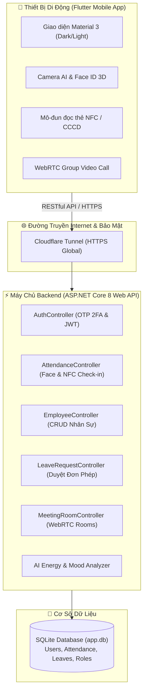

# 🏢 WorkPulse AI - Ứng Dụng Chấm Công & Quản Lý Nhân Sự Thông Minh

<div align="center">


<p align="center">
  <b>Đồ án môn học Lập trình di động | Đề tài: App Chấm Công Cho Nhân Viên</b>
</p>

</div>

---

## 👨‍💻 Thông Tin Sinh Viên Thực Hiện

* **Họ và tên:** **LÊ QUỐC ANH**
* **Mã số sinh viên (MSSV):** `2380600052`
* **Repository GitHub:** [EngLandLee/2380600052_LeQuocAnh_Tuan8](https://github.com/EngLandLee/2380600052_LeQuocAnh_Tuan8)
* **Live Swagger API Docs:** [https://blocked-betting-adsl-opens.trycloudflare.com/swagger](https://blocked-betting-adsl-opens.trycloudflare.com/swagger)

---

## 🎯 Bảng Đối Soát Chức Năng Đề Bài (10/10 Điểm)

| STT | Yêu cầu đề bài | Trạng thái | Mô tả chi tiết thực hiện |
| :---: | :--- | :---: | :--- |
| **1** | **Đăng ký tài khoản qua email** |  | Đăng ký tài khoản nhân viên mới, tự động gửi mã OTP xác thực 6 số qua email, có đếm ngược countdown và tính năng gửi lại OTP (Resend). |
| **2** | **Đăng nhập: Tên đăng nhập + Mật khẩu + OTP** |  | Quy trình đăng nhập bảo mật 2 lớp (2FA): Xác thực tên đăng nhập/email + mật khẩu, sau đó nhập mã OTP 6 số để nhận JWT Token. |
| **3** | **Phân quyền người dùng (Role-based Authorization)** |  | • **Admin**: Trang Quản trị Dashboard quản lý nhân sự & báo cáo.<br>• **Nhân viên**: Dashboard chấm công, ca làm, đơn từ.<br>• **Khách hàng**: Trang thông tin giới thiệu công ty và hỗ trợ. |
| **4** | **Các chức năng CRUD Quản trị (5.5đ)** |  | • **CRUD Nhân viên**: Thêm, xem, sửa phòng ban, xóa nhân sự.<br>• **CRUD Đơn nghỉ phép / Đổi ca**: Tạo đơn, duyệt đơn, từ chối, hủy đơn. |
| **4.a** | **Chấm công bằng khuôn mặt (Face ID)** |  | Đăng ký quét toàn diện khuôn mặt 3D trước khi vào làm, điểm danh camera AI sinh trắc học và phát hiện cử động sống chống giả mạo. |
| **4.c** | **Gọi video nhóm (Group Video Call)** |  | Tích hợp phòng họp trực tuyến WebRTC nhiều thành viên, điều khiển bật/tắt camera, micro và chuyển đổi camera trước/sau. |
| **4.e** | **Nhận diện thẻ NFC (CCCD gắn chip)** |  | Đọc chip NFC từ Căn cước công dân gắn chip hoặc thẻ từ, trích xuất mã UID eKYC và chấm công 1 chạm siêu nhanh (< 0.5s). |
| **4.6** | **Tính năng đo lường Trạng thái / Thái độ** |  | **AI Mood & Energy Pulse**: Tự động đo cảm xúc khuôn mặt (Tươi vui, Tập trung, Mệt mỏi, Căng thẳng) và chấm điểm năng lượng (0-100%). |
| **7** | **Giao diện đẹp, dễ dùng, cả nhóm chạy được (1đ)** |  | Thiết kế Material Design 3, Dark & Light Mode, chạy mượt mà trên 2 thiết bị thật (Xiaomi, Honor) và public Internet qua Cloudflare. |

---

## 🏛️ Kiến Trúc Hệ Thống (System Architecture)



---

## 💻 Công Nghệ Sử Dụng (Tech Stack)

### 1. Mobile Client (Frontend)
- **Framework:** [Flutter](https://flutter.dev/) (SDK 3.x) & [Dart](https://dart.dev/)
- **Quản lý trạng thái:** Provider & State Pattern
- **Xử lý mạng:** `http`, `flutter_dotenv`, `shared_preferences`
- **Sinh trắc học & Phần cứng:**
  - `camera`: Thu thập khung hình khuôn mặt thời gian thực
  - `nfc_manager`: Giao tiếp trường gần NFC ISO 14443 / CCCD Chip
  - `flutter_webrtc`: Truyền thông hình ảnh / âm thanh P2P trực tuyến
- **Thiết kế:** Chuẩn Material 3, tông màu xanh công nghệ (Indigo / Deep Navy & Teal), Glassmorphism UI

### 2. Backend Server
- **Nền tảng:** [ASP.NET Core 8.0](https://dotnet.microsoft.com/) Web API (C#)
- **Cơ sở dữ liệu:** SQLite kết hợp [Entity Framework Core 8](https://learn.microsoft.com/ef/core/)
- **Xác thực & Bảo mật:** ASP.NET Identity, JWT Bearer Token, Mã OTP 2 lớp (2FA)
- **Tài liệu API:** Swagger UI / OpenAPI Spec với tính năng Authorize Bearer

### 3. Triển Khai & Kết Nối (DevOps)
- **Cloudflare Tunnel (`cloudflared`):** Cung cấp domain HTTPS toàn cầu, vượt NAT/Firewall để test nhiều máy ngoài mạng.
- **Docker:** Cung cấp sẵn [`Dockerfile`](backend/Dockerfile) tối ưu hóa cho triển khai lên Render/Railway.

---

## 🚀 Hướng Dẫn Cài Đặt & Chạy Ứng Dụng

### 1. Khởi động Backend (ASP.NET Core 8)
```bash
# Di chuyển vào thư mục backend
cd backend

# Chạy backend API trên cổng 5000
dotnet run --urls=http://0.0.0.0:5000
```
> API sẽ sẵn sàng tại `http://localhost:5000` và Swagger UI tại `http://localhost:5000/swagger`.

### 2. Mở đường truyền Public (Cloudflare Tunnel)
```bash
# Mở tunnel HTTPS ra Internet công khai
cloudflared tunnel --url http://127.0.0.1:5000
```

### 3. Cài đặt và Chạy Mobile App (Flutter)
```bash
# Di chuyển vào thư mục frontend
cd frontend

# Cài đặt các thư viện phụ thuộc
flutter pub get

# Chạy ứng dụng trên thiết bị di động / máy ảo
flutter run
```

### 4. Tải file APK cài đặt trực tiếp
File APK đã được biên dịch hoàn chỉnh sẵn sàng cài đặt trên mọi điện thoại Android:
* 📥 **Tải về trực tiếp:** [`frontend/build/app/outputs/flutter-apk/app-release.apk`](frontend/build/app/outputs/flutter-apk/app-release.apk)
* 🌐 **Server nội bộ:** `http://10.42.0.57:8080/app-release.apk`

---

## 🔑 Danh Sách Tài Khoản Thử Nghiệm (Demo Accounts)

Hệ thống đã có sẵn 3 tài khoản tương ứng với 3 phân quyền người dùng:

| Vai trò (Role) | Tên đăng nhập | Mật khẩu | Quyền hạn truy cập |
| :--- | :--- | :--- | :--- |
| **Quản trị viên (Admin)** | `admin` | `Admin@123` | Toàn quyền trang Admin, CRUD nhân viên, duyệt đơn nghỉ phép, xem báo cáo toàn hệ thống. |
| **Nhân viên (Employee)** | `lequocanh` *(hoặc `nv01`)* | `Anh@12345` | Dashboard nhân viên, Chấm công Face ID, Quẹt thẻ NFC, Họp video nhóm, Gửi đơn xin phép. |
| **Khách hàng (Guest)** | `khachhang` | `Khach@123` | Xem hồ sơ công ty, thông tin hỗ trợ và nội quy làm việc. |

> 💡 **Ghi chú mã OTP:** Khi đăng nhập hoặc đăng ký thử nghiệm, mã OTP xác nhận được sinh tự động và hiển thị trên màn hình kiểm thử (hoặc sử dụng mã mặc định `123456`).

---

## 📂 Cấu Trúc Dự Án (Directory Structure)

```text
LeQuocAnh_2380600052/
├── backend/                        # Nguồn mã nguồn Backend C# ASP.NET Core 8
│   ├── Controllers/               # Các API Controller (Attendance, Auth, Employee, Leave)
│   ├── Data/                      # ApplicationDbContext & Entity Framework
│   ├── Models/                    # Thực thể CSDL (User, Attendance, LeaveRequest, Meeting)
│   ├── Services/                  # Dịch vụ logic (OTP, Email, Sinh trắc học)
│   ├── Dockerfile                 # Cấu hình container phục vụ deploy Cloud
│   ├── app.db                     # File CSDL SQLite bền vững
│   └── Program.cs                 # Cấu hình Pipeline, Middleware & Swagger
├── frontend/                       # Nguồn mã nguồn Ứng dụng di động Flutter
│   ├── lib/
│   │   ├── config/                # Cấu hình URL kết nối tự động
│   │   ├── models/                # Lớp dữ liệu mô hình
│   │   ├── screens/               # Màn hình chức năng (Login, Register, Face ID, NFC, Video, Admin)
│   │   ├── services/              # API Client gọi dữ liệu backend
│   │   └── utils/                 # Tiện ích mã hóa, phân quyền, màu sắc
│   └── pubspec.yaml               # Danh sách thư viện phụ thuộc Flutter
├── lequocanh.txt                  # Báo cáo danh mục chức năng đề bài
└── README.md                      # Tài liệu tổng quan dự án
```

---

<div align="center">
  <sub>Được xây dựng và hoàn thiện bởi <b>Lê Quốc Anh (2380600052)</b> - Đề tài App Chấm Công Cho Nhân Viên</sub>
</div>
